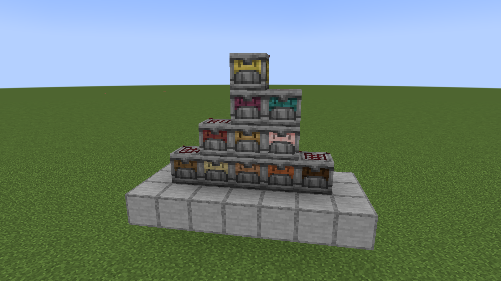

# Variant Crafters

Variant Crafters adds wood variants of Minecraft’s automatic Crafter. Each variant works like the vanilla Crafter and matches a crafting table registered by Variant Crafting Tables.

For Minecraft **1.21.1** on **Fabric**. Requires Fabric API and Variant Crafting Tables.

